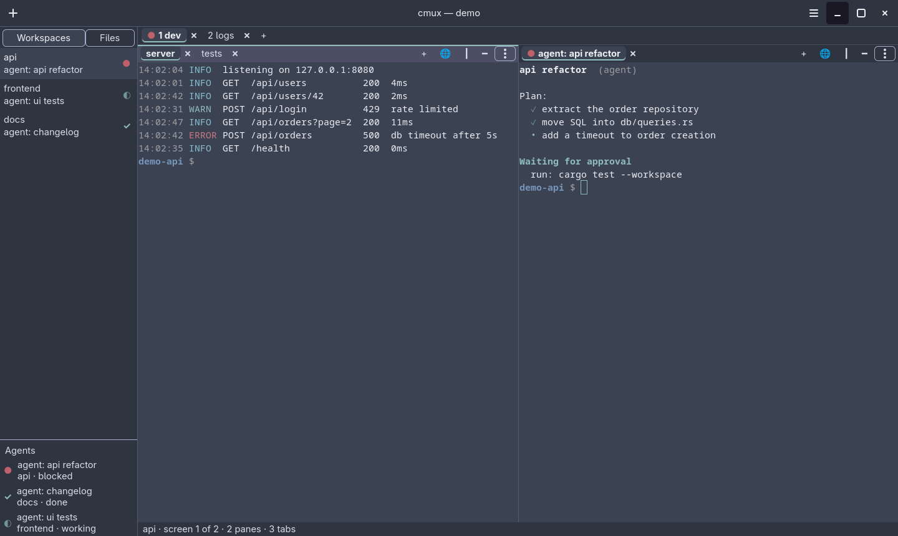
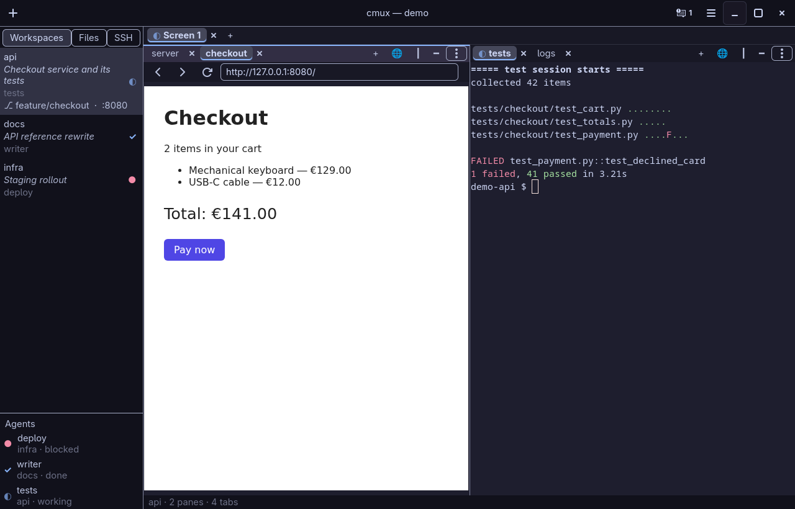
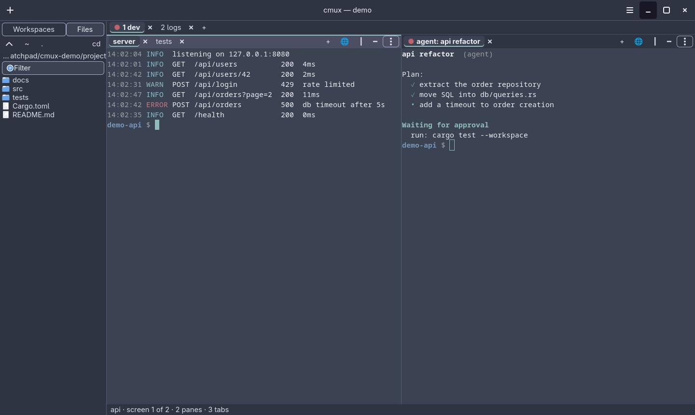
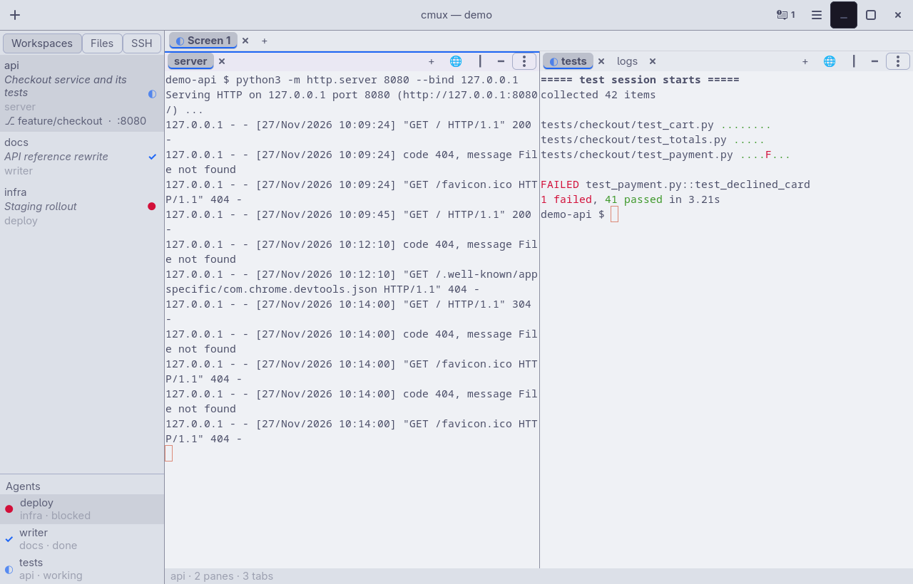

# cmux-lin

Reproducible Linux build of **cmux** — [manaflow-ai/cmux](https://github.com/manaflow-ai/cmux) — the terminal multiplexer for AI coding agents, built from upstream's Rust component `cmux-tui`, plus a native Linux window and the pieces upstream only ships for macOS.

> Unofficial. All of the multiplexer is upstream cmux by [manaflow-ai](https://github.com/manaflow-ai), built on [Ghostty](https://github.com/ghostty-org/ghostty); see [Credits](#credits).



Upstream cmux ships a native macOS app (Swift/AppKit on libghostty). That app can't be ported in a build script. What does run on Linux is `cmux-tui`, the Rust multiplexer that keeps sessions, workspaces, screens, panes, tabs, terminals and browsers, with a sidebar, agent hooks and notifications. This repo:

- pins exact upstream commits and builds `cmux-tui` on Linux, with three environment fixes ([Linux fixes](#linux-fixes)) and a small local patch ([Local patch](#local-patch));
- adds **cmux-gtk**, a native GTK4 window for a session ([gui/cmux-gtk](gui/cmux-gtk/README.md));
- adds **cmux-browser-provider**, so cmux browser tabs work on Linux ([Browser tabs](#browser-tabs));
- ships 36 themes, a `cmux-theme` switcher, and live re-theming of everything at once ([Themes](#themes)).

Status on Fedora 44 (x86_64), verified 2026-11-27:

- `30-build.sh` builds `cmux-tui` (Zig 0.16.0 builds `libghostty-vt.a`, Ghostty's VT core), the browser provider, and the GTK app when its libraries are present.
- `cmux` starts or attaches a durable session; `cmux server start` runs one headless; the TUI restores the session's layout across restarts.
- The noun-first CLI (`cmux workspace create`, `cmux terminal list`, …) works against the running session.
- cmux-gtk drives the same session: workspaces, screens, splits, tabs, browser tabs, agent badges and desktop notifications.

| Part | Included here | Notes |
|---|---|---|
| cmux-tui multiplexer (Rust + libghostty-vt) | yes | server, TUI, CLI, agent hooks, remote/machine agent |
| Native window | yes: **cmux-gtk** (GTK4 + VTE) | a client of the same session; see [gui/cmux-gtk](gui/cmux-gtk/README.md) |
| Browser tabs | yes, with **cmux-browser-provider** | needs a Chromium-based browser, only for browser tabs |
| macOS app (Swift/AppKit) | no | macOS only |
| Swift `CLI` that drives the macOS app | no | the Rust CLI covers the same protocol |

## Screenshots

| | |
|---|---|
|  |  |
| A browser tab beside an agent | The files sidebar view |
|  | |
| The window follows the theme (here Latte) | |

The screenshots come from a demo session with made-up content.

## Layout

```
cmux-lin/
├── PINS.env                      # upstream commit pins + toolchain versions
├── scripts/
│   ├── 10-install-toolchain.sh   # rustup (stable) + Zig 0.16.0 + prereq checks
│   ├── 20-fetch-source.sh        # clone cmux at the pin, init the ghostty submodule
│   ├── 30-build.sh               # build cmux-tui, the browser provider and (optionally) cmux-gtk
│   ├── 40-install.sh             # install everything to ~/.local/bin, themes, launcher entry
│   ├── cmux-theme.sh             # the cmux-theme switcher (installed as cmux-theme)
│   ├── install-theme-picker.py   # theme picker + quit key in the TUI config
│   └── convert-scrollwerk-themes.py  # generates the sw-* themes
├── patches/                      # local patch applied on top of the pinned source
├── assets/                       # default config (cmux-tui.json) and themes/
├── browser-provider/             # cmux-browser-provider (browser tabs on Linux)
├── gui/cmux-gtk/                 # the native GTK4 window
├── docs/screenshots/
└── build/                        # (gitignored) source checkout + target/
```

## Build

Prerequisites (Fedora): `git`, `curl`, `gcc`, and LLVM/clang with `libclang` (`dnf install clang-devel`). For the GTK window also `gtk4-devel` and `vte291-gtk4-devel`. Then:

```bash
./scripts/10-install-toolchain.sh
./scripts/20-fetch-source.sh
./scripts/30-build.sh
./scripts/40-install.sh
```

Everything installs into `~/.local/bin` (on the default Fedora `PATH`): `cmux-tui` with a `cmux` symlink, `cmux-tui-hook`, `cmux-browser-provider`, `cmux-theme`, and, when the GTK libraries were present at build time, `cmux-gtk` with a **cmux** entry in your application launcher. Without them the GTK window is skipped and everything else installs as usual.

## Run

```bash
cmux                                   # start the "main" session if needed, and attach the TUI
cmux --session agents                  # the same for a named session
cmux-gtk                               # the native window on "main" (or open "cmux" from the launcher)
cmux workspace create --name api       # the noun-first CLI works against the running session
cmux terminal list
```

`cmux` and `cmux-gtk` both start the session if it isn't running, after a reboot for instance. To run the session yourself instead, for example under systemd, use `cmux server start --session NAME` (it stays in the foreground) and attach with `cmux attach --session NAME`. Detach from the TUI with `Ctrl-b d`.

Upstream's docs for everything the multiplexer can do are in `build/cmux/cmux-tui/docs/` and `build/cmux/cmux-tui/spec/` after fetching.

### The GTK window

cmux-gtk is a native window for a session, built on GTK4 and VTE (the terminal widget GNOME Terminal uses). It's another client of the same server, so the TUI, the window and agents all see the same workspaces. Each window keeps its own selection, as upstream intends. It has workspaces (with each one's git branch and listening ports), screens, splits and tabs; browser tabs; drag-and-drop between panes and workspaces; agent badges, an agents queue, a notification panel and desktop notifications; a files view; a command palette with your own `cmux.json` commands; and a ☰ menu with themes and workspace actions. See [gui/cmux-gtk/README.md](gui/cmux-gtk/README.md) for everything it does.

### Browser tabs

cmux browser tabs (`Ctrl-b B` in the TUI, 🌐 in the window) are real Chromium pages that a *browser provider* lends to the session, so every client and every agent drives the same page. Upstream's provider, cmux-browser, is a patched Chromium that isn't available on Linux; without a provider, browser tabs stay at "starting". This repo has its own:

- cmux-gtk runs one built in.
- For the TUI on its own, run `cmux-browser-provider --session main` alongside the session (Ctrl-C to stop).

It needs a Chromium-based browser, but only when a browser tab exists: Chromium (`sudo dnf install chromium`), Brave or Edge, with Google Chrome as a last resort, or whatever `CMUX_LIN_BROWSER` names. It runs the browser headless with its own profile under `~/.local/share/cmux-lin/browsers/`, and the browser always exits with the provider. Terminals never need it. Details: [gui/cmux-gtk/README.md](gui/cmux-gtk/README.md#browser-tabs).

### Quitting a session

A session server keeps running when you detach (`Ctrl-b d`), when the TUI or window closes, and even when its last workspace is closed. That's deliberate, so shells survive. `Ctrl-b Q` ends the session completely: it runs `cmux server stop` against the session it's pressed in (through the inherited `CMUX_TUI_SOCKET`), every shell in it ends, and the attached TUI exits. The saved layout is kept for the next start. `scripts/install-theme-picker.py` adds this `quit-session` command on every install, unless a command with that id already exists.

In the TUI, closing a tab only removes its placement; the shell keeps running in the session (upstream's behaviour). In cmux-gtk, closing a tab, pane, screen or workspace also ends the shells it held.

## Themes

The default config, `assets/cmux-tui.json`, is a Catppuccin Mocha scheme with the original app's blue accents (active borders and rings `#89b4fa`, rounded pane corners, pill tabs, dimmed inactive panes). `40-install.sh` also installs 35 more themes and the `cmux-theme` switcher.

### What a theme controls

Each theme file is `{"theme": {...}, "ghostty": {...}}`:

- `theme`: cmux's own chrome, meaning the sidebar, tabs, pane borders, status bar, menus, prompts, toasts and notification accents. cmux-gtk styles its window from the same keys.
- `ghostty`: pane content, meaning the default background, foreground, cursor, selection and the 16-colour ANSI palette. cmux-tui reads `~/.config/ghostty/config` as the defaults for every terminal it hosts, so `cmux-theme` maintains a managed block (between `# begin/end cmux-theme managed block` markers) in that file; anything else you put there is preserved. If you also use the Ghostty terminal emulator, this file colours it too.

Layering follows the "pane one notch above the app" rule: `status_bg` (and inactive tab chips) use the palette's base layer, and the pane background uses its `surfaceContainer` equivalent, one elevation step lighter.

### Switching themes

```bash
cmux-theme list              # installed themes, * marks the active one
cmux-theme set mocha-mauve   # switch (also: mocha-blue, mocha-contrast, latte-light, default, sw-*)
cmux-theme cycle             # next theme
cmux-theme install <file>    # add your own theme (a JSON file shaped like assets/themes/*)
```

Switching swaps only the `theme` section of `~/.config/cmux/cmux-tui.json` (every other setting is preserved) and the Ghostty block, then reloads every running session. Everything re-themes in one step, without restarts: the TUI's chrome, every terminal pane, and cmux-gtk's window.

- **In the TUI:** `Ctrl-b T` cycles. Right-click the tab bar's `+` button for a menu of every installed theme (plus `Default (upstream)`), kept in sync with `~/.config/cmux/themes/` by `scripts/install-theme-picker.py` on every install.
- **In cmux-gtk:** ☰ → **Theme**.
- `cycle` goes Mocha Blue → Latte → Mocha Mauve → Mocha Contrast, then the rest alphabetically, so consecutive themes look clearly different (the three Mocha accents are near-twins).

### Live re-theming

A theme's `ghostty` section lands in `~/.config/ghostty/config`, which cmux reads as its `terminal_defaults`. The local patch pushes those defaults through the mux on every config reload, both in a TUI that hosts its own session and in a headless `cmux server start` owner. Upstream's headless reload re-read the config but kept the terminal colours it started with. One broadcast repaints every live terminal and becomes the default for terminals created later. cmux-gtk also reads the theme directly, so its terminals follow a switch at once, and it keeps text legible: at least 4.5:1 contrast for text and 3:1 for ANSI colours, nudged only as far as needed.

Content a program prints in fixed RGB colours (fastfetch logos, powerline prompt segments) keeps its literal colours, as in any terminal.

### scrollwerk themes

`scripts/convert-scrollwerk-themes.py` generates 32 themes: dark and light variants of all 16 palettes from the scrollwerk Android launcher (`Palettes.kt`): Ayu, Catppuccin, Dracula, Eldritch, Gruvbox, Kanagawa, Noctalia, Nord, Rosé Pine, Tokyo Night, Everforest, Solarized, One, Monokai Pro, Synthwave '84 and Oxocarbon, named `sw-<palette>-<dark|light>`.

Their ANSI slots are mapped by Noctalia role, not by hue: red = `error`, yellow = `primary`, blue = `hover`, magenta = `tertiary`, green = `secondary`, greys = `surfaceContainer`/`outlineVariant`. A few schemes therefore shift hue in content (Dracula "green" prints pink, for example), because that's what the source palette defines.

### Desktop pairing

`cmux-theme pair <name> <desktop-theme>` pins one of the machine's desktop themes (`~/.config/waybar/themes/<name>`, applied by the local `waybar-theme.sh`) to a cmux theme. While a pairing exists, switching to that theme also re-applies the desktop theme, retinting waybar, the niri focus ring, kitty, starship and dunst in one step. `cmux-theme unpair <name>` removes it. Pairings are per machine and stored in the theme file's optional `"desktop"` key, so nothing is coupled until you pair it, and pairings are never guessed.

### Limits

- **Themes without a `ghostty` section** (`default`) use cmux's built-in terminal defaults, and ANSI palette slots follow the host terminal's own palette.
- **Pill tab caps use Nerd Font glyphs.** Use a Nerd Font (such as JetBrains Mono Nerd Font) in the terminal running the TUI, or they render as boxes.

## Linux fixes

The upstream source builds unmodified. The three things that break a naive build are environmental, and `scripts/30-build.sh` handles them:

1. **Zig must be on `PATH`, not just `ZIG`.** `crates/ghostty-vt-sys/build.rs` uses `$ZIG` for the main `zig build`, but Ghostty's `build.zig` shells out to `zig env` through `PATH`. Symptom: `the following command failed with FileNotFound: zig env`.
2. **A stale `LD_LIBRARY_PATH` breaks bindgen.** libclang must be loadable, and anything prepending an old `libstdc++` (VS Code extension bundles are a known offender, shipping `GLIBCXX` versions older than the system LLVM) makes bindgen panic with `GLIBCXX_3.4.xx not found`. The build runs with `LD_LIBRARY_PATH` unset.
3. **bindgen needs gcc's companion headers.** Clang chokes on `/usr/include/limits.h`'s `include_next` unless gcc's include dir is passed: `BINDGEN_EXTRA_CLANG_ARGS="-I$(gcc -print-libgcc-file-name | xargs dirname)/include"`.

## Local patch

`patches/expose-chrome-theme-keys.patch` is applied on top of the pinned commit by `30-build.sh` (skipped when already applied). It changes four things:

- **Every chrome surface is themeable.** Upstream's theme schema exposes only some chrome surfaces; the rest of its internal `ChromeTheme` (context menus, prompts, toasts, the status bar's active segments, the tab-bar backdrop, sidebar chrome, omnibar, scrollbars) was fixed to xterm greys 235–246. The patch adds theme keys for all of them: `menu_bg/fg/border`, `menu_selected_bg/fg`, `prompt_bg/fg/border`, `prompt_title_fg`, `prompt_input_bg/fg`, `prompt_button_accent_fg`, `prompt_button_hover_bg`, `toast_bg/fg`, `status_active_bg/fg`, `status_dim_fg`, `tab_bar_bg`, `tab_fg`, `tab_active_fg`, `tab_active_unfocused_bg/fg`, `tab_plain_fg`, `tab_plain_active_fg`, `tab_plain_unfocused_fg`, `tab_control_hover_fg`, `sidebar_selected_bg`, `sidebar_border`, `sidebar_dim_fg`, `omnibar_fg/sep_fg/dim_fg/edit_bg/edit_fg/hover_fg`, `browser_message_fg`, `scrollbar_thumb_fg`, `scrollbar_thumb_active_fg` and `foreign_viewport_bg/boundary_fg/hint_fg`. Themes don't need to set them: any key a theme leaves out is derived from its core keys (accents from `border_active`, lines from `border_inactive`, text from `sidebar_fg`/`sidebar_selected_fg`, dim text from `status_dim_fg`, backdrops from `tab_bar_bg`/`status_bg`). Status-bar error text uses `notification_error` instead of fixed red. Chrome is re-derived on config reload, so a theme switch re-themes every surface live. Unknown theme keys are ignored by older binaries, so themes stay compatible.
- **Pane ANSI colours follow the theme.** A theme's `ghostty` palette becomes the terminal's default palette, and upstream only painted palette slots that differ from the default (OSC 4 overrides) as RGB. Every other slot went out as a plain ANSI index, so the host terminal (kitty etc.) used its own palette. Slots the Ghostty config defines now always render as RGB.
- **Terminal colours re-theme live,** in both an in-process TUI and a headless server (see [Live re-theming](#live-re-theming)).
- **Room for the theme picker:** `MAX_USER_COMMANDS` goes from 32 to 256, so a command per installed theme fits beside your own.

## Pinning philosophy

`PINS.env` holds the exact `cmux` commit, the expected ghostty submodule commit, and the Zig version and sha256. Rebuilding a different upstream revision means changing that file, not the scripts. The source checkout is shallow (a single-commit fetch of the pin), so the pins are the reproducibility contract.

## Credits

cmux-lin is an unofficial Linux build of other people's work. It isn't affiliated with or endorsed by the upstream projects.

- **[cmux](https://github.com/manaflow-ai/cmux)** by [manaflow-ai](https://github.com/manaflow-ai): the multiplexer itself. Everything `cmux-tui` does comes from upstream; this repo pins, patches and builds it, and adds the GTK window and the browser provider. Bugs found in this build should be reproduced here before being reported upstream.
- **[Ghostty](https://github.com/ghostty-org/ghostty)** by Mitchell Hashimoto and contributors: `libghostty-vt`, the terminal emulation core that cmux-tui renders every pane with.
- **[GTK](https://www.gtk.org)** and **[VTE](https://gitlab.gnome.org/GNOME/vte)**, which cmux-gtk is built on.
- **[Zig](https://ziglang.org)** and the **[Rust](https://www.rust-lang.org)** toolchain, which build the above.
- **Colour palettes:** [Catppuccin](https://github.com/catppuccin/catppuccin) (the `mocha-*` and `latte-*` themes), plus Ayu, Dracula, Eldritch, Gruvbox, Kanagawa, Noctalia, Nord, Rosé Pine, Tokyo Night, Everforest, Solarized, One, Monokai Pro, Synthwave '84 and Oxocarbon, via the scrollwerk launcher's palette definitions (the `sw-*` themes). The colours belong to their respective authors.

## License

This repository is licensed under the GNU General Public License v3.0 or later; see [LICENSE](LICENSE).

- **cmux-tui** is GPL-3.0-or-later under upstream cmux's top-level license (a few unrelated upstream server directories are BUSL-1.1; none of them are built here). The binary you build is therefore GPL-3.0-or-later.
- **Ghostty** is MIT-licensed, which is compatible with the GPL build.
- **`patches/`** modifies upstream cmux-tui source, so the patches are GPL-3.0-or-later derivative works.
- **Build scripts, themes, cmux-gtk, the browser provider and docs** are this repo's own work, released under the same GPL-3.0-or-later terms.
