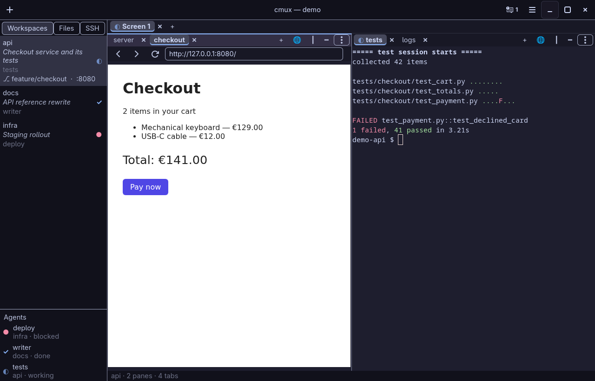

# cmux-gtk

A native GTK4 window for a cmux session, built on GTK4 and VTE (the terminal widget GNOME Terminal uses).


The cmux-tui server stays in charge of everything, and this window is just another client of it. The TUI, this window and agents all see the same workspaces, terminals and browser pages. All layout changes (splits, tabs, moves, zoom, names) are requests to the server, and the window redraws from the tree the server reports back, so its layout can't drift from the TUI's. Only the selection belongs to the window: which workspace, screen, tab and pane you're looking at is this window's alone, as in upstream's design. Switching here doesn't move the TUI or another window, and switching there doesn't move this one. Things just created (a new workspace, screen or tab, including one a tab was moved into) come into view.

| | |
|---|---|
|  |  |
| [Browser tabs](#browser-tabs) | The [Files](#sidebar) view |
|  | |
| Following the Latte theme | |

## Install

`scripts/30-build.sh` builds the window when `gtk4-devel` and `vte291-gtk4-devel` are installed, and `scripts/40-install.sh` installs it as `~/.local/bin/cmux-gtk` with a **cmux** entry in the application launcher (it opens the `main` session). From a terminal:

```bash
cmux-gtk                    # the "main" session
cmux-gtk --session work     # another session, in its own window
```

Each session gets its own window (app id `dev.cmuxlin.CmuxGtk.<session>`). `cmux-gtk --session work` opens beside the `main` window, and opening a session that already has a window brings that window up.

If the session isn't running (after a reboot, say), the window starts it, like plain `cmux` does (`cmux server ensure`), and connects. A session that stops while the window is open stays stopped; ☰ → **Start session** brings it back. If the session restarts, the window dims and waits, then reconnects by itself and re-attaches every pane.

## Workspaces, screens and panes

- **Sidebar:** the session's workspaces, with an **Agents** queue below them, and **Files** and **SSH** views one click away (see [Sidebar](#sidebar)). The header's `+` creates a workspace. Right-click a workspace for Rename, Edit description and Close.
- **Descriptions:** give a workspace a note on what it's for (right-click → **Edit description…**, ☰, the palette, or `Ctrl+Alt+E`). It shows in italics under the name. The session has no such field, so the window keeps descriptions in `~/.local/state/cmux-lin/workspace-descriptions.json`, by session and stable workspace id.
- **Screens:** a strip above the panes lists the workspace's screens (cmux's equivalent of tmux windows, each with its own layout). Click one to switch, `×` to close it, `+` for a new one. Each screen button shows the most urgent agent badge on that screen.
- **Splits:** the active screen's split layout is drawn as resizable panes. Dragging a divider moves it in the TUI too, and the other way round.
- **Tabs:** every pane has a tab strip. Click a tab to switch, `×` to close, `+` for a new tab, `🌐` for a browser tab, `┃`/`━` to split right/down, `⋮` for the pane menu (zoom, swap with a neighbour, rename tab, undo, close pane).
- **Renaming:** double-click a workspace, screen or tab. An empty name goes back to the default.
- **Drag and drop:** drag a tab to reorder it, onto another pane's tab strip or body to move it there, onto a workspace in the sidebar to move it to that workspace, or into the empty sidebar space for a new workspace. The terminal or browser keeps running.
- **Undo:** the pane menu's **Undo layout change** (`Ctrl+Shift+U`) undoes the screen's last split, swap, zoom or resize. An undo that would close panes asks first and says how many. The pane menu also has **Move tab to new workspace**, and **Move pane to workspace ▸**, which moves the whole pane (every tab, in order, as one pane) to another workspace or a new one. The terminals and browsers keep running. The window follows the pane there. The session has no command for moving a pane, so the window splits the destination's active pane, moves each tab into the new pane, and closes the placeholder shell the split made.
- **Viewport columns:** screens laid out in columns (the TUI's `Ctrl-b g`, here `Ctrl+Shift+G` or the pane menu's **New column to the right**) show as a horizontally scrolling row. Each column takes its own fraction of the visible width, has its own splits inside, and resizes by dragging its right edge.
- **Zoom:** a zoomed pane fills its screen (pane menu, `Ctrl+Shift+Z`, or the TUI), and the split comes back when you unzoom.

### Closing ends the shells

Closing a tab (`×`, `Ctrl+Shift+W`), a pane (pane menu), a screen (`×` on the screen strip) or a workspace (☰ menu or right-click) also ends the shells it held, via `close-terminal`. The server's own close commands only remove the layout, which would leave the shells running unseen in the session (the TUI behaves that way). A single tab closes at once. A pane or screen with two or more shells, and any workspace, asks first and says how many will end.

## Terminals

- Keystrokes and pastes go to the pane you're typing in.
- Resizing the window or a pane resizes that terminal on the server, so the shell reflows.
- `Ctrl+Shift+C` copies the selection, and `Ctrl+Shift+V` or `Shift+Insert` pastes. Plain Ctrl+C/V belong to the program running.
- Right-click opens a menu with Copy, Paste, Select all, Find, New tab, Split right/down and Zoom. Shift+right-click goes to the program instead, for terminal apps that use the mouse.
- **Find** (`Ctrl+Shift+F`) opens a bar above the terminal that searches the scrollback and screen as you type, newest output first. Enter or ↑ goes to the previous (older) match, Shift+Enter or ↓ to the next, wrapping around. **Aa** matches case, and **.\*** treats the text as a regular expression; otherwise it's matched literally. The field turns red when nothing matches. Escape closes the bar and returns to the terminal.
- **Text size:** `Ctrl++` and `Ctrl+−` make every terminal's text larger or smaller in 10% steps, and `Ctrl+0` resets it. The size is remembered between runs (in `~/.local/state/cmux-lin/gtk-font-scale`), and the shells reflow to the new grid.

## Themes

The whole window follows the active cmux theme: the terminal colours, and the window's own chrome (header, sidebar, tab strips, menus and dividers), styled from the theme's chrome keys (`status_bg`/`status_fg`, `sidebar_active_bg`, `tab_bar_bg`/`tab_active_bg`, `menu_*`, `border_active` as the accent). It restyles live whenever the theme changes, whether from the ☰ menu, `cmux-theme` or the TUI.

☰ → **Theme** lists every installed cmux theme with the current one marked. Picking one runs `cmux-theme set`, the same as the TUI's picker, so it switches everywhere at once: the config, the Ghostty colour block, every session's terminals, and this window (plus the desktop theme, if you paired one).

Terminal text stays legible in any theme; see [How it works](#how-it-works).

## Command palette

`Ctrl+Shift+P` (or ☰ → **Command palette**) opens a search field over everything you can run:

- your custom commands (below);
- every workspace and tab, to jump to by name (`Go to workspace: api`, `Go to tab: server`);
- the window's actions (new tab, splits, zoom, find, text size, notifications, workspace actions and more), each with its shortcut shown on the right;
- every installed theme.

Type to filter. Every word has to match the name, its description or its keywords, either as written or as scattered letters (`thm lat` finds `Theme: latte-light`), and matches at the start of a name or word rank first. Up/Down or Ctrl+N/P move, Enter or a click runs, Escape closes.

### Custom commands

The palette reads the simple commands from the macOS app's `cmux.json` format:

- the project's `.cmux/cmux.json` (or `cmux.json`), found by searching upward from the focused workspace's folder;
- `~/.config/cmux/cmux.json` for every project.

A project entry wins over a user-wide one with the same name.

```json
{
  "commands": [
    { "name": "Format changed files", "description": "Prettier on what changed", "keywords": ["lint"],
      "command": "git diff --name-only main -- '*.ts' | xargs npx prettier --write" },
    { "name": "Reset local database", "command": "./scripts/db-reset.sh", "confirm": true }
  ]
}
```

Picking one types its `command` into the focused terminal and runs it, so it runs wherever that shell is. Start it with `cd "$(git rev-parse --show-toplevel)" &&` when it needs the repository root. With `"confirm": true` the palette asks first.

### Workspace layout commands

A command with a `workspace` object instead of a `command` opens a new workspace: a tree of splits whose leaves are panes of terminal and browser tabs, in the same format as the macOS app:

```json
{
  "commands": [
    {
      "name": "API Stack",
      "restart": "confirm",
      "workspace": {
        "name": "API",
        "cwd": "./services/api",
        "env": { "PORT": "8080" },
        "setup": "nvm use",
        "layout": {
          "direction": "vertical",
          "split": 0.65,
          "children": [
            { "direction": "horizontal", "children": [
              { "pane": { "surfaces": [ { "type": "terminal", "name": "Server", "command": "go run ./cmd/api", "focus": true } ] } },
              { "pane": { "surfaces": [ { "type": "terminal", "name": "Worker", "command": "go run ./cmd/worker", "env": { "QUEUE": "default" } } ] } }
            ] },
            { "pane": { "surfaces": [
              { "type": "terminal", "name": "Logs", "cwd": "/var/log", "command": "tail -F system.log" },
              { "type": "browser", "name": "Health", "url": "http://localhost:8080/healthz" }
            ] } }
          ]
        }
      }
    }
  ]
}
```

**Splits:**
- A split has a `direction`: `horizontal` puts its two `children` side by side, and `vertical` stacks them.
- `split` is the first child's share, from 0.1 to 0.9 (default 0.5).

**Panes and tabs:**
- A pane lists its tabs in `surfaces`.
- A tab is a `terminal` (with an optional `command`) or a `browser` (with a `url`), and can have a `name`, `cwd` and `env`.
- The tab marked `focus` gets the keyboard; otherwise the first tab does.

**Folders and environment:**
- `cwd` values starting with `~/` are in your home folder, absolute ones are used as written, and anything else is relative to the workspace's `cwd`.
- The workspace's `cwd` is relative to the project folder, or for the user-wide file, to the focused workspace's folder.
- `env` on the workspace applies to every terminal in it.
- `setup` runs in the first terminal before its command.

**`restart`** decides what happens when a workspace with that name already exists:
- `new` (the default) opens another one;
- `confirm` asks, then replaces it;
- `recreate` replaces it straight away;
- `ignore` switches to it.

Replacing ends the old workspace's shells.

**How it's built:** the window builds the workspace step by step: new workspace, splits, tabs, names, divider positions. The session has no per-terminal environment, and no start folder for split panes. So each terminal gets a short line typed into its shell first, `cd` to its folder and `export` its variables, followed by `clear`. A leading space keeps that line out of shell history. Then come `setup` and the command.

**Not supported:** the workspace `color`, because the session has no workspace colours.

**Errors:** an entry with a mistake (a split without exactly two children, a browser without a `url`) is skipped, and listed at the top of the palette with the reason.

The TUI's own `commands` (from `~/.config/cmux/cmux-tui.json`) are listed too, and run as a new tab the way the TUI runs them. **Quit session** asks first.

Scripts can use the palette as well: `app.palette-text` opens it with a query, and `app.palette-run` runs the best match for one:

```bash
gdbus call --session --dest dev.cmuxlin.CmuxGtk.main --object-path /dev/cmuxlin/CmuxGtk/main \
  --method org.gtk.Actions.Activate palette-run '[<"format changed files">]' '{}'
```

## Settings

`Ctrl+,` (or ☰ → **Settings…**, or the palette) opens the settings window. Changes apply at once:

| Section | Settings |
|---|---|
| Appearance | Theme, terminal font, text size |
| Terminal | Scrollback lines, cursor shape, blinking cursor |
| Window | Desktop notifications, branch and ports in the sidebar, start the session automatically |
| Browser tabs | The built-in browser provider on or off, and which browser it uses (Automatic, or any Chromium-family browser found on `PATH`) |
| Config files | Open the session's `cmux-tui.json`, the user-wide `cmux.json` (created empty if missing) and the Ghostty colours file, and ask the session to reload its config |

The window's settings are saved in `~/.config/cmux-lin/gtk.json`. The theme is stored where `cmux-theme` keeps it, and the text size in `~/.local/state/cmux-lin/gtk-font-scale`. The session's own settings (keys, the TUI's sidebar and status bar, user commands) stay in `cmux-tui.json`. Changing the browser restarts the built-in provider, so the next browser tab uses the new one. A browser chosen here wins over `CMUX_LIN_BROWSER`.

## The ☰ menu

**Command palette**, **Settings…**, **Theme**, the sidebar view, Find and text size, the notification actions, **Start session**, **Sessions ▸**, and New / Rename / Edit description / Close workspace.

### Sessions

☰ → **Sessions** lists every session: the running ones first, then the stopped ones whose layout the session saved. Picking one opens it in its own window, and a stopped session starts again with its saved layout. Picking this window's own session just raises it. **Reopen closed window** at the top brings back the session whose window you closed last. Each window records itself in `~/.local/state/cmux-lin/closed-windows` when it closes. The palette has the same entries (`Open session: …`, `Reopen closed window: …`).

## Browser tabs

A cmux browser tab is a real Chromium page that the session gets from a *browser provider*, so the TUI, this window and agents all see and drive the same page. cmux-tui never runs a browser itself, and upstream's provider (cmux-browser, a patched Chromium) isn't publicly buildable, so this repo has its own:

- **Built in.** The app starts a provider when it connects, unless another one is already registered. When the session has a browser tab, it launches a headless Chromium-family browser, opens a page for every browser tab, and registers them. It takes the browser chosen in Settings, else `CMUX_LIN_BROWSER` if set, otherwise the first of `chromium`, `chromium-browser`, `ungoogled-chromium`, `brave-browser`, `brave`, `microsoft-edge`, `google-chrome-stable`, `google-chrome` on `PATH`. Each browser gets its own profile in `~/.local/share/cmux-lin/browsers/<name>`, so logins persist. Turn it off in Settings, or for one run with `CMUX_GTK_NO_PROVIDER=1`.
- **Standalone.** `cmux-browser-provider [--session NAME]` does the same without the window, so browser tabs also work in the TUI (which draws them with kitty graphics). It's its own crate, [`browser-provider/`](../../browser-provider), with no GTK dependency, and `scripts/40-install.sh` installs it. Stop it with Ctrl-C or `kill`.

The browser never outlives its provider, even if the app is killed with `kill -9` or crashes. It's started with `--remote-debugging-pipe`, and Chromium exits when that pipe closes, which the kernel does whenever the provider's process ends. A parent-death signal alone isn't enough, because some launchers, Brave's for one, run the real browser as a grandchild.

If no browser can be started, the provider says so once, in the browser tab and the status line (the standalone provider prints it), and retries quietly every 30 seconds.

In the window, a browser tab has an address bar (bare domains get `https://`) plus back, forward and reload. Clicks, drags, scrolling and typing are forwarded to the page. Each click quotes the frame it was aimed at, the protocol's guard against clicking a page that changed underneath you.

Select text as in any browser: drag, double-click a word, triple-click a line, Shift+arrows, or Ctrl+A. Then use the desktop clipboard:

| Keys | Action |
|---|---|
| `Ctrl+C` or `Ctrl+Shift+C` | Copy the selection |
| `Ctrl+X` | Cut (copy, then delete the selection in a text field) |
| `Ctrl+V`, `Ctrl+Shift+V` or `Shift+Insert` | Paste |

File uploads work as usual: activate a page's file field and the desktop file dialog opens, picking one file or several as the field allows, and the chosen files go to the page. A headless browser can't show a file dialog, so the window intercepts the page's request over DevTools (`Page.setInterceptFileChooserDialog`) and answers it with the files you pick (`DOM.setFileInputFiles`). Cancelling leaves the field empty. Only local files can be uploaded.

Right-click a page for a menu: **Open link in new tab** and **Copy link address** when over a link, then Back, Forward, Reload, Copy, Paste, Select all, **Inspect (F12)**, and **Open page in default browser** (hands the page to your desktop browser). The Menu key or Shift+F10 opens it from the keyboard. **Shift+right-click** sends the click to the page instead, for sites with their own context menus. The headless browser never shows menus itself, and the window finds the link under the pointer by asking the page over DevTools.

The page runs in a headless browser whose own clipboard isn't the desktop's, so the window handles the clipboard itself. Copy asks the page for its selection over the DevTools Protocol (the selected part of a focused text field, otherwise the page selection), using the endpoint the provider registered, since the session protocol's `copy` only covers terminals. Paste types the clipboard text into the page. Both are also exposed as the actions `app.browser-copy` and `app.browser-paste`, and the menu as `app.browser-menu`.

### DevTools

`F12` in a browser tab, **Inspect** in its right-click menu, or the palette's **Developer tools** opens the browser's own DevTools for that page in a new pane beside it: Elements, Console, Network, Sources and the rest. It's the DevTools front-end the provider's browser serves on loopback (`http://127.0.0.1:PORT/devtools/inspector.html?ws=…/devtools/page/<target>`), shown in an ordinary browser tab, so it's driven like any other page.

### Importing cookies

So browser tabs start out logged in, Settings → Browser tabs → **Import cookies** (or the palette's `Import cookies from …`) copies the cookies of one of your browser profiles into the provider's browser. It finds the profiles of Chromium, Chrome, Brave, Edge and Vivaldi (Flatpak installs too) and of Firefox.

- The cookie store is read from a temporary copy (owner-only, removed afterwards), so the browser can stay open.
- Firefox stores values in plain text.
- Chromium-family browsers encrypt them: `v10` values with a fixed key, `v11` values with a key from the browser's password in your desktop keyring, read with `secret-tool`. The keyring may ask to be unlocked.
- Expired cookies are skipped.
- The cookies go into the running browser with DevTools `Storage.setCookies`, so a browser tab has to be open first.

Nothing leaves your machine. Cookies imported this way stay in the provider's profile (`~/.local/share/cmux-lin/browsers/<name>`) until they expire or the site replaces them.

## Agent attention and notifications

Each tab gets a mark, ranked most urgent first the same way every cmux client ranks them:

| Mark | Meaning |
|---|---|
| red `●` | an agent is waiting for you (blocked) |
| `✓` | an agent finished a turn you haven't looked at yet |
| `●` in the level's colour | an unread notification (error, warning, info) |
| `◐` | an agent is working |

Each sidebar row shows its workspace's most urgent mark and how many tabs need you, across all its screens. Each screen button does the same for its own screen, so you can see which hidden screen needs you. Clicking a notification switches to the right workspace, screen and tab. Colours come from the active cmux theme's notification colours.

When a tab with a finished turn or an unread notification is on screen and the window has focus, the app tells the server you've seen it (`ack-tab-notifications`), the same way the TUI does. That clears the mark everywhere, TUI included.

Notifications also go to the desktop notification service (dunst, GNOME Shell and so on), unless you're already looking at that terminal. Clicking one jumps to its tab. The latest notification also shows in the status line for a few seconds.

### Notification panel

The bell in the header bar shows how many notifications are unread and opens the panel (`Ctrl+Shift+I`). It lists every notification the session keeps (up to 256), newest first. Each row shows its level mark, title, body, workspace and tab, and how long ago it arrived. Unread rows have a filled mark and a bold title.

- Click a row to jump to its tab. Seeing the tab marks its notifications read, as it does in the TUI.
- `Ctrl+Shift+J` jumps to the tab of the newest unread notification.
- **Mark all read** clears every unread marker, as if you had looked at each tab.
- **Clear all** deletes the session's notifications, for every window and the TUI.

The same actions are in the ☰ menu. A notification whose tab has closed stays in the list, marked "tab closed", until it's cleared.

The panel reads the notifications through the session's resource protocol (`notification.list`, `notification.ack`, `notification.clear`). Seeing a tab clears its marker for every client. When the window sees a notification become read, it also records it as read by this window (`read_by`), because a new notification on the same terminal re-flags the older ones as unread on the server.

## Sidebar

The sidebar has three views, switched at its top or with `Ctrl+Shift+Y` (it cycles through them):

- **Workspaces**: each row shows the workspace's name, its description, its active tab's title and, when there are any, the git branch of that tab's folder, the branch's pull request, and the TCP ports the workspace's programs listen on (`⎇ main  ·  #42 open ✓  ·  :3000 :5173`). Hover a row for the full folder. While agents run, the **Agents** queue sits underneath, listing every agent across all workspaces, blocked first, then finished, working, idle, unknown, the most recent change first within each. Each row shows the tab's name and its workspace; click one to jump to its tab.
- **Files**: a browser on the focused terminal's working directory, following it as you `cd` (asked from the session with `process-info`) until you navigate yourself; `~` follows again. Double-click or Enter opens a folder, or a file in `$EDITOR` in a new tab. `c` (or the `cd` button) changes the focused pane to the selected folder, `o` opens `.md`/`.html` in a browser tab, `.` shows dotfiles, Backspace goes up, and the field filters by name.
- **SSH**: other machines to open a workspace on. It lists the hosts in `~/.ssh/config` (and the files it `Include`s, wildcard patterns left out), the SSH machines in the cmux config's `machines`, and the hosts you connected to recently. The field at the top takes any `user@host`. Picking one opens a new workspace named after the host, with `ssh <host>` typed into an ordinary shell. Your SSH config applies (keys, jump hosts, ports), and when ssh ends or fails, the terminal stays with the reason and a local shell. The palette has `SSH: <host>` entries. This is plain SSH in a local terminal, not cmux-tui's remote daemon (`cmux-tui remote`).

### Branch and ports

The server doesn't track branches or ports, so the window works them out itself every 3 seconds, since it runs on the same machine as the session:

- `process-info` gives each terminal's shell process and working folder (the foreground program's, if it reports one).
- The branch is read from the repository around the active terminal's folder (`.git/HEAD`, worktrees included; a detached head shows its short commit id). No `git` process is run.
- Ports are the listening TCP sockets (`/proc/net/tcp` and `tcp6`) held by any terminal's shell in the workspace, or by anything started under it. A program that detaches from its shell (a daemon) isn't counted.
- The pull request comes from GitHub's `gh` CLI: `gh pr view` in that folder, with your own `gh` login. It runs at most once a minute per folder and branch and shows the number, state (open, draft, merged, closed) and checks: ✓ passed, ✗ failing, … running. Hover for the title. The palette's `Open pull request #…` opens it in your browser. Without `gh`, outside a GitHub repository, or with no PR, nothing is shown. Turn it off in Settings.

## Keyboard shortcuts

They act on the pane you're typing in (the palette, settings, workspace, notification and text size keys work anywhere):

| Keys | Action |
|---|---|
| `Ctrl+Shift+T` | New tab |
| `Ctrl+Shift+W` | Close tab |
| `Ctrl+Shift+E` | Split right |
| `Ctrl+Shift+O` | Split down |
| `Ctrl+Shift+B` | New browser tab |
| `Ctrl+PageDown` / `Ctrl+PageUp` | Next / previous tab |
| `Ctrl+Tab` / `Ctrl+Shift+Tab` | Next / previous tab |
| `Ctrl+1`…`Ctrl+8` / `Ctrl+9` | Tab 1–8 / last tab of the pane |
| `Ctrl+Alt+←→↑↓` | Focus the pane in that direction |
| `Ctrl+Alt+Shift+←→↑↓` | Move the nearest divider that way (5%) |
| `Ctrl+Shift+H` | Flash the focused pane |
| `Ctrl+Shift+Z` | Zoom / unzoom the pane |
| `Ctrl+Shift+U` | Undo the screen's last layout change |
| `Ctrl+Shift+G` | New column to the right (viewport columns) |
| `Ctrl+Shift+P` | Command palette |
| `Ctrl+,` | Settings |
| `Ctrl+Shift+F` | Find in the terminal |
| `Ctrl++` / `Ctrl+−` / `Ctrl+0` | Larger / smaller / normal text (every terminal) |
| `Ctrl+Shift+Y` | Sidebar: next view (Workspaces, Files, SSH) |
| `Ctrl+Alt+E` | Edit the workspace's description |
| `F12` | DevTools (in a browser tab) |
| `Ctrl+Shift+I` | Notification panel |
| `Ctrl+Shift+J` | Jump to the latest unread notification |
| `Ctrl+Shift+C` / `Ctrl+Shift+V` | Copy / paste in a terminal pane (also `Shift+Insert`) |
| `Ctrl+Shift+N` | New screen |
| `Ctrl+Shift+PageDown` / `Ctrl+Shift+PageUp` | Next / previous screen |
| `Alt+1`…`Alt+8` / `Alt+9` | Workspace 1–8 / last workspace |
| `Alt+PageDown` / `Alt+PageUp` | Next / previous workspace |

The window takes these keys before the terminal does, so a program in a pane doesn't get them (for example `Alt+1` as readline's digit argument, or `Ctrl+Tab`).

Directional focus goes by where panes are on screen, so it works across splits and viewport columns alike, and flashes the pane it lands on. Resizing moves the divider the way a drag does, so the TUI follows. The same moves are available to scripts as the action `app.nav` with a name: `workspace-N`, `workspace-next`, `workspace-prev`, `tab-N`, `tab-next`, `tab-prev`, `focus-<dir>`, `resize-<dir>` (`left`, `right`, `up`, `down`) or `flash`, for example:

```bash
gdbus call --session --dest dev.cmuxlin.CmuxGtk.main --object-path /dev/cmuxlin/CmuxGtk/main \
  --method org.gtk.Actions.Activate nav '[<"focus-right">]' '{}'
```

## Requirements

- **Always:** cmux-tui (the window starts the session if needed), plus `gtk4-devel` and `vte291-gtk4-devel` to build.
- **Only for browser tabs:** a Chromium-based browser, for example Chromium (`sudo dnf install chromium`), Brave or Microsoft Edge. Google Chrome works too, but it's only used if nothing else is installed, because it reports usage to Google even when run headless. Firefox can't be used: cmux talks to pages over the Chrome DevTools Protocol, which Firefox no longer supports. Without one, everything else works, and a browser tab says what's missing instead of showing a page.

## Build from source

Needs `gtk4-devel` and `vte291-gtk4-devel`, plus the upstream source fetched by `scripts/20-fetch-source.sh` (the app uses upstream's Rust SDK from there).

```bash
cd gui/cmux-gtk
cargo run --release -- --session main
```

A session with no workspaces shows an empty sidebar until you press `+` or attach the TUI once.

## How it works

Each pane's visible terminal gets its own connection to the session socket, attached in byte mode. The server first sends a replay of the screen, then live output, all as ordinary terminal escape sequences that VTE renders directly. Input (`send`) and size reports (`resize-surface`) go over **that same connection**.

That last part is a protocol rule: the server sizes a terminal from its attached viewers only, treats every connection as a separate viewer, and gives the size to the most recently active one. A resize sent on any other connection comes back `accepted: false`. The Rust SDK's raw attach stream doesn't let you send on its connection, so the attachment code speaks the protocol's newline-delimited JSON directly. The workspace tree is read the same way (`list-workspaces`), because the SDK's typed tree drops fields the window needs. Workspace creation still goes through the SDK.

The tree is re-read every 1.5 s and straight after every action. If a tree poll fails, the window closes every attachment, dims itself and blocks input, and the control thread retries the socket every second. When a tree can be read again, each pane re-attaches and gets a fresh screen replay. Pane widgets are reused by pane id, so a restart that keeps the layout doesn't rebuild anything; shells running in the session survive a server restart.

A third connection subscribes to session events. `notification` events become desktop notifications, and tree, agent and notification events trigger an immediate re-poll of the tree and the agent roster (`list-agents`), so badges update within a moment rather than on the next poll.

Terminal colours come from the active theme itself: the `~/.config/ghostty/config` block `cmux-theme` writes, which is also what the server loads. The window reads it directly and re-colours every terminal as soon as it changes, so a theme switch shows at once whatever colours the server is holding. A program's own colour changes (OSC 10/11/12 and OSC 4, which the server reports as overrides) still win. After that comes a legibility guard: text gets at least 4.5:1 contrast against the background and ANSI colours 1–15 at least 3:1, each nudged toward white or black only as far as needed, so a theme with low-contrast pairs stays readable. Colour 0 is left as is, because it's mostly used as a background. Colours a program prints in fixed RGB, such as powerline prompt segments, keep their literal values, as in any terminal.

## Not done

- cmux-tui's own remote machines (`cmux-tui remote`, a cmux daemon on the other machine) and custom sidebar plugins (`sidebar.plugin`). The SSH view opens plain SSH sessions instead.
- the workspace `color` of layout commands (the session has no workspace colours).

## Debugging

- `CMUX_GTK_SNAPSHOT=/abs/path.png` renders the window to that PNG every 2 s, without screen capture, plus `path-notes.png` while the notification panel is open.
- `CMUX_GTK_DEBUG=1` logs per-pane size reports to stderr.
