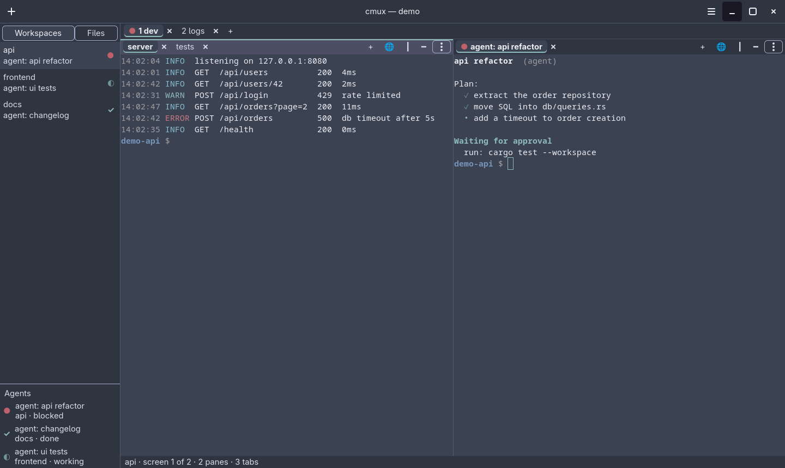
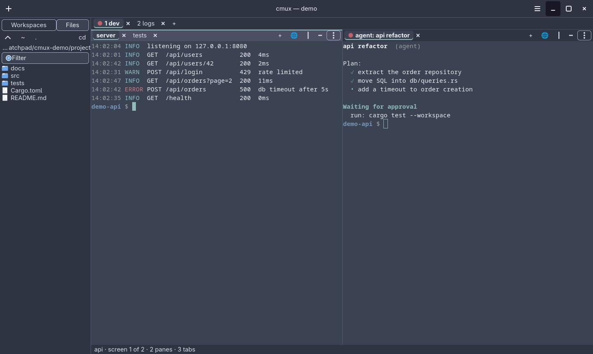
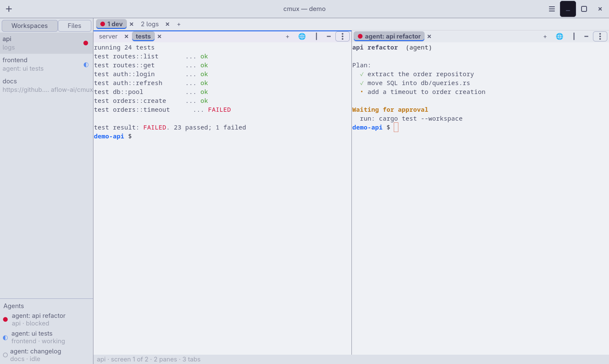

# cmux-gtk

A native GTK4 window for a cmux session, built on GTK4 and VTE (the terminal widget GNOME Terminal uses).



The cmux-tui server stays in charge of everything, and this window is just another client of it. The TUI, this window and agents all see the same workspaces, terminals and browser pages. All layout changes (splits, tabs, moves, zoom, names) are requests to the server, and the window redraws from the tree the server reports back, so its layout can't drift from the TUI's. Only the selection belongs to the window: which workspace, screen, tab and pane you're looking at is this window's alone, as in upstream's design. Switching here doesn't move the TUI or another window, and switching there doesn't move this one. Things just created (a new workspace, screen or tab, including one a tab was moved into) come into view.

| | |
|---|---|
|  |  |
| [Browser tabs](#browser-tabs) | The [Files](#sidebar) view |
|  | |
| Following the Latte theme | |

## Install

`scripts/30-build.sh` builds the window when `gtk4-devel` and `vte291-gtk4-devel` are installed, and `scripts/40-install.sh` installs it as `~/.local/bin/cmux-gtk` with a **cmux** entry in the application launcher (it opens the `main` session). From a terminal:

```bash
cmux-gtk                    # the "main" session
cmux-gtk --session work     # another session, in its own window
```

Each session gets its own window (app id `dev.cmuxlin.CmuxGtk.<session>`). `cmux-gtk --session work` opens beside the `main` window, and opening a session that already has a window brings that window up.

If the session isn't running (after a reboot, say), the window starts it, like plain `cmux` does (`cmux server ensure`), and connects. A session that stops while the window is open stays stopped; ☰ → **Start session** brings it back. If the session restarts, the window dims and waits, then reconnects by itself and re-attaches every pane.

## Workspaces, screens and panes

- **Sidebar:** the session's workspaces, with an **Agents** queue below them and a **Files** view one click away (see [Sidebar](#sidebar)). The header's `+` creates a workspace. Right-click a workspace for Rename and Close.
- **Screens:** a strip above the panes lists the workspace's screens (cmux's equivalent of tmux windows, each with its own layout). Click one to switch, `×` to close it, `+` for a new one. Each screen button shows the most urgent agent badge on that screen.
- **Splits:** the active screen's split layout is drawn as resizable panes. Dragging a divider moves it in the TUI too, and the other way round.
- **Tabs:** every pane has a tab strip. Click a tab to switch, `×` to close, `+` for a new tab, `🌐` for a browser tab, `┃`/`━` to split right/down, `⋮` for the pane menu (zoom, swap with a neighbour, rename tab, undo, close pane).
- **Renaming:** double-click a workspace, screen or tab. An empty name goes back to the default.
- **Drag and drop:** drag a tab to reorder it, onto another pane's tab strip or body to move it there, onto a workspace in the sidebar to move it to that workspace, or into the empty sidebar space for a new workspace. The terminal or browser keeps running.
- **Undo:** the pane menu's **Undo layout change** (`Ctrl+Shift+U`) undoes the screen's last split, swap, zoom or resize. An undo that would close panes asks first and says how many. The pane menu also has **Move tab to new workspace**.
- **Viewport columns:** screens laid out in columns (the TUI's `Ctrl-b g`, here `Ctrl+Shift+G` or the pane menu's **New column to the right**) show as a horizontally scrolling row. Each column takes its own fraction of the visible width, has its own splits inside, and resizes by dragging its right edge.
- **Zoom:** a zoomed pane fills its screen (pane menu, `Ctrl+Shift+Z`, or the TUI), and the split comes back when you unzoom.

### Closing ends the shells

Closing a tab (`×`, `Ctrl+Shift+W`), a pane (pane menu), a screen (`×` on the screen strip) or a workspace (☰ menu or right-click) also ends the shells it held, via `close-terminal`. The server's own close commands only remove the layout, which would leave the shells running unseen in the session (the TUI behaves that way). A single tab closes at once. A pane or screen with two or more shells, and any workspace, asks first and says how many will end.

## Terminals

- Keystrokes and pastes go to the pane you're typing in.
- Resizing the window or a pane resizes that terminal on the server, so the shell reflows.
- `Ctrl+Shift+C` copies the selection, and `Ctrl+Shift+V` or `Shift+Insert` pastes. Plain Ctrl+C/V belong to the program running.
- Right-click opens a menu with Copy, Paste, Select all, New tab, Split right/down and Zoom. Shift+right-click goes to the program instead, for terminal apps that use the mouse.

## Themes

The whole window follows the active cmux theme: the terminal colours, and the window's own chrome (header, sidebar, tab strips, menus and dividers), styled from the theme's chrome keys (`status_bg`/`status_fg`, `sidebar_active_bg`, `tab_bar_bg`/`tab_active_bg`, `menu_*`, `border_active` as the accent). It restyles live whenever the theme changes, whether from the ☰ menu, `cmux-theme` or the TUI.

☰ → **Theme** lists every installed cmux theme with the current one marked. Picking one runs `cmux-theme set`, the same as the TUI's picker, so it switches everywhere at once: the config, the Ghostty colour block, every session's terminals, and this window (plus the desktop theme, if you paired one).

Terminal text stays legible in any theme; see [How it works](#how-it-works).

## The ☰ menu

**Start session**, **Theme**, the Workspaces/Files switch, and New / Rename / Close workspace.

## Browser tabs

A cmux browser tab is a real Chromium page that the session gets from a *browser provider*, so the TUI, this window and agents all see and drive the same page. cmux-tui never runs a browser itself, and upstream's provider (cmux-browser, a patched Chromium) isn't publicly buildable, so this repo has its own:

- **Built in.** The app starts a provider when it connects, unless another one is already registered. When the session has a browser tab, it launches a headless Chromium-family browser, opens a page for every browser tab, and registers them. It takes `CMUX_LIN_BROWSER` if set, otherwise the first of `chromium`, `chromium-browser`, `ungoogled-chromium`, `brave-browser`, `brave`, `microsoft-edge`, `google-chrome-stable`, `google-chrome` on `PATH`. Each browser gets its own profile in `~/.local/share/cmux-lin/browsers/<name>`, so logins persist. Set `CMUX_GTK_NO_PROVIDER=1` to turn it off.
- **Standalone.** `cmux-browser-provider [--session NAME]` does the same without the window, so browser tabs also work in the TUI (which draws them with kitty graphics). It's its own crate, [`browser-provider/`](../../browser-provider), with no GTK dependency, and `scripts/40-install.sh` installs it. Stop it with Ctrl-C or `kill`.

The browser never outlives its provider, even if the app is killed with `kill -9` or crashes. It's started with `--remote-debugging-pipe`, and Chromium exits when that pipe closes, which the kernel does whenever the provider's process ends. A parent-death signal alone isn't enough, because some launchers, Brave's for one, run the real browser as a grandchild.

If no browser can be started, the provider says so once, in the browser tab and the status line (the standalone provider prints it), and retries quietly every 30 seconds.

In the window, a browser tab has an address bar (bare domains get `https://`) plus back, forward and reload. Clicks, drags, scrolling and typing are forwarded to the page. Each click quotes the frame it was aimed at, the protocol's guard against clicking a page that changed underneath you.

Select text as in any browser: drag, double-click a word, triple-click a line, Shift+arrows, or Ctrl+A. Then use the desktop clipboard:

| Keys | Action |
|---|---|
| `Ctrl+C` or `Ctrl+Shift+C` | Copy the selection |
| `Ctrl+X` | Cut (copy, then delete the selection in a text field) |
| `Ctrl+V`, `Ctrl+Shift+V` or `Shift+Insert` | Paste |

File uploads work as usual: activate a page's file field and the desktop file dialog opens, picking one file or several as the field allows, and the chosen files go to the page. A headless browser can't show a file dialog, so the window intercepts the page's request over DevTools (`Page.setInterceptFileChooserDialog`) and answers it with the files you pick (`DOM.setFileInputFiles`). Cancelling leaves the field empty. Only local files can be uploaded.

Right-click a page for a menu: **Open link in new tab** and **Copy link address** when over a link, then Back, Forward, Reload, Copy, Paste, Select all, and **Open page in default browser** (hands the page to your desktop browser). The Menu key or Shift+F10 opens it from the keyboard. **Shift+right-click** sends the click to the page instead, for sites with their own context menus. The headless browser never shows menus itself, and the window finds the link under the pointer by asking the page over DevTools.

The page runs in a headless browser whose own clipboard isn't the desktop's, so the window handles the clipboard itself. Copy asks the page for its selection over the DevTools Protocol (the selected part of a focused text field, otherwise the page selection), using the endpoint the provider registered, since the session protocol's `copy` only covers terminals. Paste types the clipboard text into the page. Both are also exposed as the actions `app.browser-copy` and `app.browser-paste`, and the menu as `app.browser-menu`.

## Agent attention and notifications

Each tab gets a mark, ranked most urgent first the same way every cmux client ranks them:

| Mark | Meaning |
|---|---|
| red `●` | an agent is waiting for you (blocked) |
| `✓` | an agent finished a turn you haven't looked at yet |
| `●` in the level's colour | an unread notification (error, warning, info) |
| `◐` | an agent is working |

Each sidebar row shows its workspace's most urgent mark and how many tabs need you, across all its screens. Each screen button does the same for its own screen, so you can see which hidden screen needs you. Clicking a notification switches to the right workspace, screen and tab. Colours come from the active cmux theme's notification colours.

When a tab with a finished turn or an unread notification is on screen and the window has focus, the app tells the server you've seen it (`ack-tab-notifications`), the same way the TUI does. That clears the mark everywhere, TUI included.

Notifications also go to the desktop notification service (dunst, GNOME Shell and so on), unless you're already looking at that terminal. Clicking one jumps to its tab. The latest notification also shows in the status line for a few seconds.

## Sidebar

Like the TUI's, the sidebar has two views, switched at its top or with `Ctrl+Shift+F`:

- **Workspaces**, with the **Agents** queue underneath while agents run: every agent across all workspaces, blocked first, then finished, working, idle, unknown, the most recent change first within each. Each row shows the tab's name and its workspace; click one to jump to its tab.
- **Files**: a browser on the focused terminal's working directory, following it as you `cd` (asked from the session with `process-info`) until you navigate yourself; `~` follows again. Double-click or Enter opens a folder, or a file in `$EDITOR` in a new tab. `c` (or the `cd` button) changes the focused pane to the selected folder, `o` opens `.md`/`.html` in a browser tab, `.` shows dotfiles, Backspace goes up, and the field filters by name.

## Keyboard shortcuts

They act on the pane you're typing in:

| Keys | Action |
|---|---|
| `Ctrl+Shift+T` | New tab |
| `Ctrl+Shift+W` | Close tab |
| `Ctrl+Shift+E` | Split right |
| `Ctrl+Shift+O` | Split down |
| `Ctrl+Shift+B` | New browser tab |
| `Ctrl+PageDown` / `Ctrl+PageUp` | Next / previous tab |
| `Ctrl+Shift+Z` | Zoom / unzoom the pane |
| `Ctrl+Shift+U` | Undo the screen's last layout change |
| `Ctrl+Shift+G` | New column to the right (viewport columns) |
| `Ctrl+Shift+F` | Sidebar: Workspaces / Files |
| `Ctrl+Shift+C` / `Ctrl+Shift+V` | Copy / paste in a terminal pane (also `Shift+Insert`) |
| `Ctrl+Shift+N` | New screen |
| `Ctrl+Shift+PageDown` / `Ctrl+Shift+PageUp` | Next / previous screen |

## Requirements

- **Always:** cmux-tui (the window starts the session if needed), plus `gtk4-devel` and `vte291-gtk4-devel` to build.
- **Only for browser tabs:** a Chromium-based browser, for example Chromium (`sudo dnf install chromium`), Brave or Microsoft Edge. Google Chrome works too, but it's only used if nothing else is installed, because it reports usage to Google even when run headless. Firefox can't be used: cmux talks to pages over the Chrome DevTools Protocol, which Firefox no longer supports. Without one, everything else works, and a browser tab says what's missing instead of showing a page.

## Build from source

Needs `gtk4-devel` and `vte291-gtk4-devel`, plus the upstream source fetched by `scripts/20-fetch-source.sh` (the app uses upstream's Rust SDK from there).

```bash
cd gui/cmux-gtk
cargo run --release -- --session main
```

A session with no workspaces shows an empty sidebar until you press `+` or attach the TUI once.

## How it works

Each pane's visible terminal gets its own connection to the session socket, attached in byte mode. The server first sends a replay of the screen, then live output, all as ordinary terminal escape sequences that VTE renders directly. Input (`send`) and size reports (`resize-surface`) go over **that same connection**.

That last part is a protocol rule: the server sizes a terminal from its attached viewers only, treats every connection as a separate viewer, and gives the size to the most recently active one. A resize sent on any other connection comes back `accepted: false`. The Rust SDK's raw attach stream doesn't let you send on its connection, so the attachment code speaks the protocol's newline-delimited JSON directly. The workspace tree is read the same way (`list-workspaces`), because the SDK's typed tree drops fields the window needs. Workspace creation still goes through the SDK.

The tree is re-read every 1.5 s and straight after every action. If a tree poll fails, the window closes every attachment, dims itself and blocks input, and the control thread retries the socket every second. When a tree can be read again, each pane re-attaches and gets a fresh screen replay. Pane widgets are reused by pane id, so a restart that keeps the layout doesn't rebuild anything; shells running in the session survive a server restart.

A third connection subscribes to session events. `notification` events become desktop notifications, and tree, agent and notification events trigger an immediate re-poll of the tree and the agent roster (`list-agents`), so badges update within a moment rather than on the next poll.

Terminal colours come from the active theme itself: the `~/.config/ghostty/config` block `cmux-theme` writes, which is also what the server loads. The window reads it directly and re-colours every terminal as soon as it changes, so a theme switch shows at once whatever colours the server is holding. A program's own colour changes (OSC 10/11/12 and OSC 4, which the server reports as overrides) still win. After that comes a legibility guard: text gets at least 4.5:1 contrast against the background and ANSI colours 1–15 at least 3:1, each nudged toward white or black only as far as needed, so a theme with low-contrast pairs stays readable. Colour 0 is left as is, because it's mostly used as a background. Colours a program prints in fixed RGB, such as powerline prompt segments, keep their literal values, as in any terminal.

## Not done

- moving whole panes between workspaces (tabs move; a pane empties and closes);
- the TUI's machines view and custom sidebar plugins (`sidebar.plugin`), which need remote machines or a plugin configured on the server.

## Debugging

- `CMUX_GTK_SNAPSHOT=/abs/path.png` renders the window to that PNG every 2 s, without screen capture.
- `CMUX_GTK_DEBUG=1` logs per-pane size reports to stderr.
